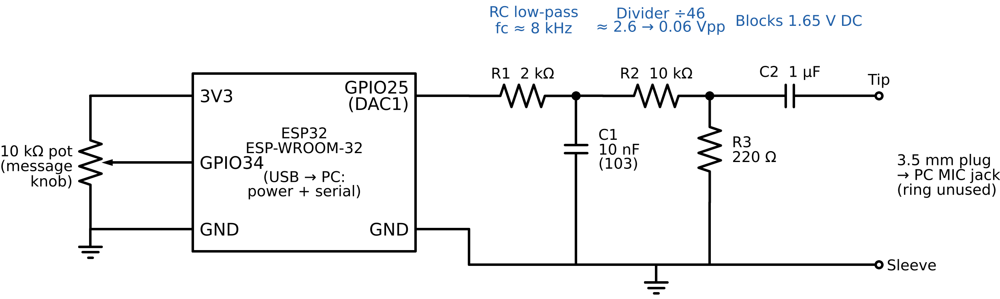

# Hardware Build Guide

Everything you need to build the physical transmitter. If you only want to run the project in
simulation, you don't need any of this. See the README's "Without hardware" column.



## Parts

| Part | Value | Notes |
| --- | --- | --- |
| ESP32 dev board | ESP-WROOM-32 (original ESP32) | Needs the built-in DAC on GPIO25. ESP32-S3 / C3 have no DAC. |
| R1 | 2 kΩ | RC low-pass resistor |
| C1 | 10 nF (marked "103" or "2A103J") | RC low-pass capacitor |
| R2 | 10 kΩ | Divider, top |
| R3 | 220 Ω | Divider, bottom |
| C2 | 1 µF | DC block (non-polarized ceramic or film preferred) |
| Potentiometer | 10 kΩ | Optional live message knob |
| 3.5 mm audio cable | any old headphone/aux cable you can cut | Provides the plug for the PC mic jack |
| Breadboard + jumper wires, USB cable | | USB powers the ESP32 and carries serial commands |
| Multimeter with continuity (beep) mode | | To identify the cable's wires |

## Wiring

| From | To |
| --- | --- |
| ESP32 GPIO25 | R1 |
| R1 other end (node A) | C1 to GND, and R2 |
| R2 other end (node B) | R3 to GND, and C2 |
| C2 other end | 3.5 mm plug **tip** wire |
| ESP32 GND | breadboard ground rail, and 3.5 mm plug **sleeve** wire |
| Pot outer pins | ESP32 3V3 and GND |
| Pot middle pin (wiper) | ESP32 GPIO34 |

Plug the 3.5 mm plug into the computer's **microphone** input (usually the pink jack), and plug the ESP32 into USB.

## Finding the right wires in a 3.5 mm cable

A 3.5 mm plug has separate metal sections, and each one connects to one wire inside the cable.
Wire colors are **not standardized**, so you have to test which wire goes to which section.

### 1. Know the plug sections

```
   tip   ring   sleeve
   ___    __    _______
  (___|==|__|==|_______|====== cable
```

- **Tip:** the very end of the plug. For a PC mic input this is the **signal**.
- **Ring:** the middle band (or two bands on a 4-pole "TRRS" plug). Not used here.
- **Sleeve:** the long section nearest the cable. For a PC mic input this is **ground**.

A plug with **two** black rings is a 4-pole TRRS (headset) plug. It still works in a separate pink mic jack
using tip = signal and sleeve = ground. Laptop **combo** headset jacks are different: they usually put the mic on
the sleeve and ground on the second ring (the CTIA layout), so for a combo jack use a USB sound card or a
headset splitter adapter that gives a separate mic plug.

### 2. Open the cable

1. Cut the cable about 15 cm (6 in) from the plug, keeping the plug end.
2. Strip about 3 cm of the outer jacket.
3. Inside you will typically find:
   - **White or tan fibers that look like string:** strength fibers. They are not wires, so cut them off.
   - **A bare, twisted copper bundle:** usually the shield/ground (often the sleeve).
   - **Thin colored wires (red, green, gray, copper-colored):** the signal wires.
4. Thin "copper" wires are usually **enamel-coated**, so a multimeter won't beep through the coating.
   Remove about 1 cm of coating by scraping gently with a blade or by tinning it with a hot soldering iron.
   Then twist each wire's strands together.

### 3. Test each wire with a multimeter

1. Set the multimeter to **continuity** (the speaker/beep symbol). Touch the probes together to confirm it beeps.
2. Put one probe on the plug's **tip**. Touch the other probe to each stripped wire in turn.
   The wire that beeps is the **tip (signal)** wire.
3. Repeat with the probe on the **sleeve** to find the **ground** wire.
4. Repeat with the probe on the **ring** to find the ring wire, then tape it off so it touches nothing.
5. Write down the result. In this project's cable: **gray = tip, red = ring, bare copper = sleeve**.
   Yours may differ.

If a wire never beeps, the coating is probably still on. Scrape or tin it again.

### 4. Connect

- **Tip wire** → C2 (the signal output)
- **Sleeve wire** → ground rail
- **Ring wire** → not connected (insulate it)

## Check it works

1. Upload the firmware (`firmware/`, PlatformIO: Build, then Upload).
2. Open the serial monitor at 115200 baud and type `mode carrier`.
3. With the multimeter on DC volts, GPIO25 to GND should read about **1.65 V** (DAC mid-scale).
4. On the PC, select the mic input, then run `python pm_gui.py --port /dev/ttyUSB0 --device <index>`
   from `receiver/` (find the index with `python -m sounddevice`).
   You should see one spike at 4000 Hz and `level ... ok`.
5. If the level says `CLIPPING`, lower the mic input volume (for example in pavucontrol on Linux).
   If it says `too quiet`, check the tip and sleeve wires.
